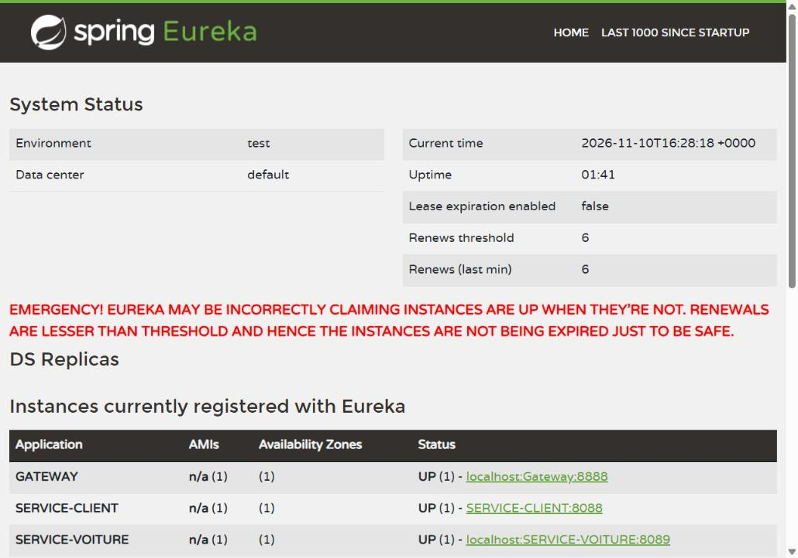
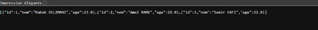
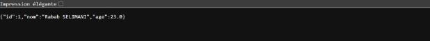
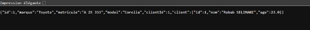
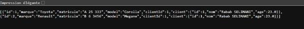
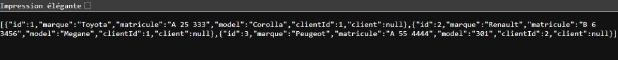

# TP 19 — Orchestration de microservices avec Spring Cloud

**Eureka · API Gateway · OpenFeign · Load Balancer**

Ce dépôt contient la réalisation complète du TP 19 du module *Architecture Microservices : Conception, Déploiement et Orchestration* : un registre de services (Eureka), deux microservices métier (clients et voitures) qui communiquent avec OpenFeign, et une API Gateway qui route les requêtes en s'appuyant sur Eureka.

---

## Architecture

```
                    ┌──────────────────────────┐
                    │   Eureka Server  :8761   │
                    │  (registre des services) │
                    └────▲──────────▲──────▲───┘
            inscription  │          │      │  inscription
                         │          │      │
 Navigateur ──► ┌────────┴───┐      │   ┌──┴─────────────────┐
                │  Gateway   │──────┼──►│ SERVICE-CLIENT     │
                │   :8888    │      │   │ :8088 (H2, JPA)    │
                └────────┬───┘      │   └──▲─────────────────┘
                         │          │      │ OpenFeign
                         │      ┌───┴──────┴─────────┐
                         └─────►│ SERVICE-VOITURE    │
                                │ :8089 (H2, JPA)    │
                                └────────────────────┘
```

| Module | Dossier | Nom Eureka | Port | Rôle |
|---|---|---|---|---|
| Eureka Server | `tp19/eureka-server` | — | 8761 | Registre / découverte de services |
| Microservice Client | `tp19/client` | `SERVICE-CLIENT` | 8088 | CRUD des clients (H2 en mémoire) |
| Microservice Voiture | `tp19/voiture` | `SERVICE-VOITURE` | 8089 | CRUD des voitures, appelle SERVICE-CLIENT via OpenFeign |
| API Gateway | `tp19/gateway` | `GATEWAY` | 8888 | Point d'entrée unique, routage dynamique via Eureka |

### Flux d'une requête
1. Au démarrage, chaque microservice s'inscrit dans Eureka avec son `spring.application.name`.
2. Le client (navigateur) appelle la Gateway sur le port 8888.
3. La Gateway résout la route : avec le routage dynamique, `/SERVICE-VOITURE/**` → `lb://SERVICE-VOITURE`.
4. Spring Cloud LoadBalancer choisit une instance parmi celles fournies par Eureka.
5. SERVICE-VOITURE traite la requête et, si besoin, appelle SERVICE-CLIENT via **OpenFeign**.
6. La réponse remonte jusqu'à la Gateway, puis au client.

---

## Technologies

- Java 17 (compilé et testé avec JDK 21)
- Spring Boot **4.1.2**
- Spring Cloud **2025.1.4** : Netflix Eureka, Gateway (WebFlux), OpenFeign, LoadBalancer
- Spring Data JPA + base **H2** en mémoire
- Lombok, Spring Boot Actuator, DevTools
- Maven, IntelliJ IDEA

---

## Structure du dépôt

```
.
├── README.md
├── screenshots/                 # captures des tests
└── tp19/
    ├── eureka-server/           # @EnableEurekaServer
    ├── client/                  # entities / repositories / controllers
    ├── gateway/                 # DiscoveryClientRouteDefinitionLocator
    └── voiture/                 # entities / repositories / services (Feign) / controllers
```

---

## Étapes réalisées

### Étape 3 — Eureka Server
- Dépendance `spring-cloud-starter-netflix-eureka-server`, annotation `@EnableEurekaServer`.
- Port 8761 ; `register-with-eureka=false` et `fetch-registry=false` car le serveur ne s'enregistre pas lui-même.

### Étape 4 — SERVICE-CLIENT
- Entité JPA `Client(id, nom, age)`, `ClientRepository`, `ClientController`.
- Endpoints : `GET /clients`, `GET /client/{id}`.
- `CommandLineRunner` qui insère 3 clients de test dans H2.
- Inscription dans Eureka via `@EnableDiscoveryClient` et `eureka.client.service-url.defaultZone`.

### Étape 5 — Gateway (configuration statique)
- Routes `/clients/**` et `/client/**` vers l'URL fixe `http://localhost:8088`.
- Cette configuration est conservée dans `gateway/src/main/resources/app.yml` (désactivée à l'étape 6).

### Étape 6 — Gateway avec Eureka
- **Partie A** : bean `RouteLocator` avec `uri("lb://SERVICE-CLIENT")` (laissé en commentaire dans `GatewayApplication`).
- **Partie B (version active)** : bean `DiscoveryClientRouteDefinitionLocator`. Chaque service inscrit dans Eureka obtient automatiquement la route `/NOM-DU-SERVICE/**`.

### Étapes 7 et 8 — SERVICE-VOITURE + OpenFeign
- Entité `Voiture(id, marque, matricule, model, clientId)` ; le champ `client` est `@Transient` (non stocké, récupéré via Feign).
- Interface Feign `ClientService` annotée `@FeignClient(name = "SERVICE-CLIENT")`, activée par `@EnableFeignClients`.
- `VoitureController` : `GET /voitures`, `GET /voitures/{id}`, `GET /voitures/client/{id}`, `POST /voitures/{clientId}`, `PUT /voitures/{id}`.

### Étape 9 — Routes Gateway vers SERVICE-VOITURE
- Grâce au routage dynamique, SERVICE-VOITURE est accessible sans configuration supplémentaire : `http://localhost:8888/SERVICE-VOITURE/voitures`.

---

## Lancer le projet

Ordre de démarrage (chaque module se lance depuis IntelliJ avec ▶, ou avec Maven) :

```bash
cd tp19/eureka-server && mvn spring-boot:run   # 1. attendre "Started Eureka Server"
cd tp19/client        && mvn spring-boot:run   # 2.
cd tp19/voiture       && mvn spring-boot:run   # 3. après l'inscription de SERVICE-CLIENT
cd tp19/gateway       && mvn spring-boot:run   # 4.
```

> SERVICE-VOITURE appelle SERVICE-CLIENT dès son démarrage (insertion des données de test) : SERVICE-CLIENT doit déjà être visible dans Eureka.

---

## Tests et captures d'écran (Étape 10)

### Eureka — les 3 services sont inscrits
`http://localhost:8761/`



> Le message rouge « EMERGENCY! » correspond au mode *self-preservation* d'Eureka ; il est normal en environnement local.

### SERVICE-CLIENT (port 8088)
`http://localhost:8088/clients`



`http://localhost:8088/client/1`



### SERVICE-VOITURE (port 8089)
`http://localhost:8089/voitures`


`http://localhost:8089/voitures/1` — la voiture est enrichie avec son client, récupéré via **OpenFeign**



`http://localhost:8089/voitures/client/1` — les voitures du client n°1



### Gateway — routage dynamique (port 8888)
`http://localhost:8888/SERVICE-CLIENT/clients`


`http://localhost:8888/SERVICE-VOITURE/voitures`



---

## Adaptations par rapport à l'énoncé

L'énoncé a été écrit pour une version antérieure de Spring Cloud. Avec Spring Boot 4.1.2 / Spring Cloud 2025.1, les ajustements suivants ont été faits :

| Point | Énoncé | Réalisation |
|---|---|---|
| Dépendance Gateway | `spring-cloud-starter-gateway` | `spring-cloud-starter-gateway-server-webflux` (nouveau nom de l'artefact) |
| Propriétés de routes YAML | `spring.cloud.gateway.routes` | `spring.cloud.gateway.server.webflux.routes` |
| Champ de liaison voiture → client | `id_client` / `clientId` mélangés | `clientId` partout (`findByClientId`, `getClientId`) |
| Chemin appelé par Feign | `/clients/{id}` | `/client/{id}`, l'endpoint réellement exposé par SERVICE-CLIENT |
| `Voiture.client` | `@Transient @ManyToOne` | `@Transient` seul (Client n'est pas une entité de SERVICE-VOITURE) |
| Interface Feign | classe interne `VoitureApplication.ClientService` | interface dédiée `services/ClientService` |

---

## Concepts clés

- **Service discovery (Eureka)** : registre dynamique, heartbeats + TTL, cache côté client, self-preservation.
- **API Gateway** : point d'entrée unique ; routage statique (URI fixe), via Eureka (`lb://NOM`) ou dynamique (`/NOM/**`).
- **Load balancing côté client** : Spring Cloud LoadBalancer choisit une instance parmi celles d'Eureka.
- **OpenFeign** : client HTTP déclaratif pour la communication synchrone entre microservices.
- **Données isolées** : chaque microservice possède sa propre base H2.
